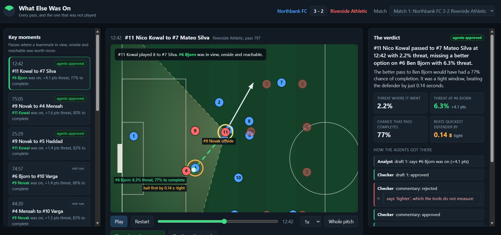

# What Else Was On

**Every pass, and the one that was not played.**

A team of AI agents watches a football match and, for every pass, asks: *what else was on?* It works out which teammates the passer could actually see, finds a better option they skipped, checks that the pass would really have arrived, and turns the best moments into broadcast commentary that has been fact-checked against the numbers.

**Demo Video:** https://youtu.be/X6NDYfazrmY
**Live demo:** https://whatelse.proudbeach-cfbbc1d8.southafricanorth.azurecontainerapps.io/
(if nobody has used it for a while, the first load takes about 20 to 30 seconds to wake up)

Built for the Microsoft x Premier League **Inside the Game: Developer Hackathon** (October 2026). All matches, teams and players are synthetic and generated by this repo.



## Try it in one minute

1. Open the live demo. The first key moment (12:42) loads on its own.
2. The clip plays and **stops at the moment of the pass**: the yellow wedge is what the passer could see, the white arrow is the pass he played, the green dashed arrow is what else was on.
3. Press **Play what else was on**: the missed pass is played out, with the quickest defender chasing it, and you see by how much the ball would have got there first.
4. The right panel shows the commentary, the key numbers, and **how the agents got there**: every draft, every check, every rejection.
5. Pick a moment marked "not run" and press **Run the agents on this pass** to watch the team work live on Microsoft Foundry.

## Why

Broadcasts and analysts judge passes by where the ball went. The more interesting question is what the player *chose not to do*, and it is only fair to ask it about options the player could actually see and actually reach. Language models are good at telling that story but bad at keeping numbers straight, so this project gives the story to the agents and the numbers to code, and makes the agents prove every claim.

## How it works

```
match (22 players + ball, 10 frames/s)
   |
football tools (code): vision cone, offside, expected threat, will the pass arrive, completion chance
   |
Analyst agent --> Checker agent --approved--> Narrator agent <--> Checker --> commentary, pundit line, recap
      ^               |
      +---rejected----+   (problems go back to the Analyst; after 3 drafts a plain verdict from the tools is used)
```

| Part | What it does | Built with |
|---|---|---|
| Match generator | Simulates 22 players and the ball at 10 frames per second: formations, pressing, runs, passes, shots, tackles, fouls, offsides | Python, NumPy |
| Football tools | 120 degree vision cone, offside, expected threat (Karun Singh's public xT grid), pass arrival against the quickest defender, completion probability (xP) | Python, exposed to the agents as tools |
| Analyst agent | Calls the tools and writes a verdict with its evidence | Microsoft Agent Framework, gpt-4.1-mini on Microsoft Foundry |
| Checker agent | Recomputes the verdict in code, then reviews the wording; rejects anything the numbers do not support | Microsoft Agent Framework, gpt-4.1 on Microsoft Foundry |
| Narrator agent | Writes a commentary line, a pundit line and a post-match recap, each checked again | Microsoft Agent Framework, Microsoft Foundry |
| Orchestration | Analyst, Checker and Narrator wired as a workflow with a rejection loop | Agent Framework `WorkflowBuilder` |
| Replay page | Pitch, cone, missed option, "ghost" pass, agent trail; runs the agents live | FastAPI, HTML canvas |
| Hosting | One container, tests and image build on every push, Foundry key as a secret | Azure Container Apps, GitHub Actions, GitHub Container Registry |

## Why you can trust the numbers

- **The agents never compute anything.** Every number comes from the tools; the Checker calls `verify_verdict`, plain code that recomputes the pass and compares every field.
- **Rules that a model might bend are enforced in code:** every number in any text must appear in the evidence; "tight" is used exactly when the pass would have beaten the defender by under 0.3 s; claims the tools cannot measure ("wide open", "safer", "would have scored") are rejected; the completion chance must be described as a completion chance.
- **A stronger model reviews the wording** (gpt-4.1 as the Checker), and rejected text goes back with the reasons.
- **Nothing unchecked reaches the screen:** if the agents cannot agree in 3 drafts, a plain verdict straight from the tools is shown and labelled as such. Every rejection is kept in the trail you can see on the page.
- **38 tests**, including the whole agent workflow against a local stand-in model, run on every push.

## Limitations

- The matches are synthetic: a simple simulator, not real football. It is good enough to produce realistic passing decisions, and it keeps the project free of licensed match data.
- Threat uses Karun Singh's public 12 x 8 xT grid (learned from real Premier League events); it is downloaded at build time and not stored in this repo.
- The reach model is deliberately simple (a defender reacts after 0.7 s, then sprints at 7 m/s; the ball rolls at 12.5 m/s), and the completion curve is fitted on synthetic passes (AUC 0.69).
- Live runs on the public demo are capped at 20 a day to protect the model budget; saved stories are always shown.

## Football tools and the Analyst agent

```bash
python scripts/get_xt_grid.py                           # once: download Karun Singh's xT grid
python scripts/explain_pass.py --seed 1                 # biggest missed options in the match (no AI)
python scripts/explain_pass.py --seed 1 --pass 797      # full table for one pass
python scripts/run_analyst.py --seed 1 --pass 797       # the Analyst agent on the same pass
```

A "better option" is a teammate inside the passer's 120 degree vision cone, not offside, worth at least 0.5 percentage points more threat than the pass played, and reachable: a ground pass at 12.5 m/s gets there before any defender who reacts after 0.7 s and sprints at 7 m/s.

What the numbers mean:
- **Threat** is expected threat (xT): the chance a move ends in a goal soon if the ball is at that spot. The tools use [Karun Singh's public 12 x 8 xT grid](https://karun.in/blog/expected-threat.html), learned from a season of Premier League event data, with bilinear interpolation between cells. The grid is Karun Singh's work and is not included in this repo; download it once with `python scripts/get_xt_grid.py`. Without it, the tools fall back to a hand-made xT-style map. The match generator always uses the hand-made map to decide where its players pass, so the judge (Karun's grid) is independent of the rule the simulated players follow.
- **xP** is the chance a pass is completed, from how much time the ball has to spare over the quickest defender. It is a logistic curve fitted on 4,851 passes from synthetic matches 1-3 (`scripts/fit_xp.py`, AUC 0.69).
- **Offside**: the receiver is in the opponents' half, ahead of the ball and ahead of the second-last opponent at the moment of the pass.

## The agent team

```bash
python scripts/run_pipeline.py --seed 1 --pass 797            # one pass through the whole team
python scripts/run_pipeline.py --seed 1 --top 3 --recap       # the 3 biggest misses, plus a post-match recap
python scripts/run_pipeline.py --seed 1 --top 3 --mock        # same, with a local stand-in model (no Azure)
```

The three agents run as a Microsoft Agent Framework workflow (`src/whatelse/pipeline.py`):

```
pass id --> Analyst --> Checker --approved--> Narrator <--> Checker --> commentary + pundit line
               ^           |
               +-rejected--+   (the Checker's problems go back to the Analyst, at most 3 drafts)
```

- **Analyst** calls the football tools and writes a verdict with its evidence.
- **Checker** never trusts the Analyst. It calls `verify_verdict`, plain code that recomputes the pass and compares every number and label, and then reads the wording: a better option that was never played must be described with "would have", and a pass that would only just have beaten the defender (under 0.3 s to spare) must be called tight. A verdict is approved only if the code and the Checker both find no problems.
- **Narrator** writes a live commentary line and a pundit line from the approved verdict, and a post-match recap from several. Its words are checked too, the same way: any number that is not in the verdict, or any claim the verdict does not support (for example calling the better option "safer"), sends it back to the Narrator with the Checker's problems.

The Checker can run on a stronger model than the other agents: set `AZURE_OPENAI_CHECKER_MODEL` in `.env` to a second deployment (for example gpt-4.1). Judging wording is the hardest job in the team, and the Checker only reads a few short verdicts per match, so this costs little.

If the agents cannot agree after 3 drafts, the pipeline uses a plain verdict written straight from the tools and marks the story "fallback", so nothing unchecked reaches the screen. Every story keeps a trail of what each agent did, saved to `data/stories_<seed>.json`.

## The replay page

```bash
python scripts/serve.py          # then open http://localhost:8000
```

Pick a key moment on the left. The clip plays and stops at the moment of the pass, showing the passer's 120 degree vision cone, the pass played (white arrow) and what else was on (green dashed arrow), with any offside teammates marked. **Play what else was on** plays the pass that was not made: the ball travels at 12.5 m/s and the quickest defender chases it with the same reaction-and-sprint model the tools use, so you can see how close the call would have been. The right panel shows the agents' commentary, the key numbers, and every step of the Analyst, Checker and Narrator, including rejections. **Run the agents on this pass** runs the team live (needs `.env`) and saves the result to `data/stories_<seed>.json`.

The backend (`src/whatelse/app.py`) is a small FastAPI app: `/api/matches`, `/api/matches/{seed}`, `/api/matches/{seed}/moments/{pass_id}` and a POST to `.../run`.

## Running it in the cloud

The whole app (replay page, API and agents) is one container: see the `Dockerfile` and
[docs/DEPLOY.md](docs/DEPLOY.md). On every push, GitHub Actions runs the tests and publishes the
image to GitHub Container Registry; Azure Container Apps runs it. The Foundry key is stored as a
Container Apps secret, and `WHATELSE_LIVE_RUNS` caps how many live agent runs the public page may
start per day (saved stories are always shown).

```bash
docker build -t whatelse .
docker run -p 8000:8000 --env-file .env whatelse      # the same container on your own machine
```

## The synthetic match generator

```bash
python scripts/generate_match.py --seed 1          # full match, about 40 s
python scripts/preview_match.py --seed 1 --minute 20
```

This writes `data/match_1_tracking.npz` (positions), `data/match_1_events.json` (teams, players, events, summary) and `data/match_1_preview.png` (a picture to check it looks like football). The same seed always gives the same match.

How it works, in short: both teams keep a formation that slides with the ball; the defending team presses the ball carrier with its nearest player and covers with the next; attackers make runs in behind. The ball carrier dribbles, then shoots or passes. Passes are chosen mostly among teammates the carrier can see, and players are a little cautious, so better options are sometimes skipped. Passes roll along the ground and can be cut out by a defender who reaches the ball's path first. All team and player names are made up.

## Quick start

```bash
python -m venv .venv
# Windows
.venv\Scripts\activate
# macOS / Linux
source .venv/bin/activate

pip install -r requirements.txt
copy .env.example .env      # Windows (use cp on macOS / Linux), then fill in your values
python scripts/smoke_test.py          # checks the model connection
python scripts/smoke_test.py --mock   # runs without Azure
```

See [docs/SETUP.md](docs/SETUP.md) for the Azure and Foundry steps.

## Data

Every match in this project is synthetic. No real match footage or match data is used or included. The only outside input is Karun Singh's public xT grid (a table of 96 numbers), which is downloaded from his site rather than stored here, and credited above.

## Licence

MIT, see [LICENSE](LICENSE).
